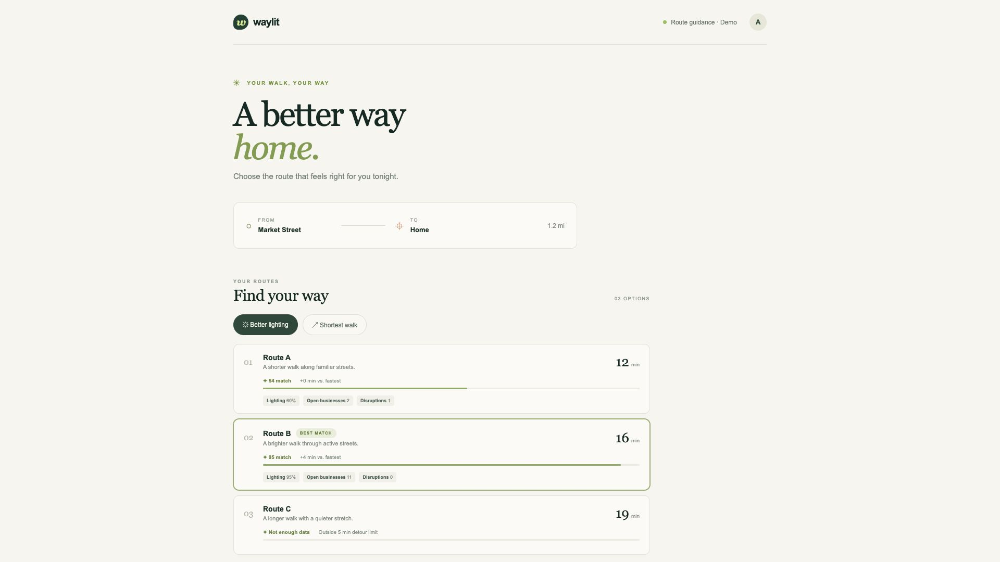
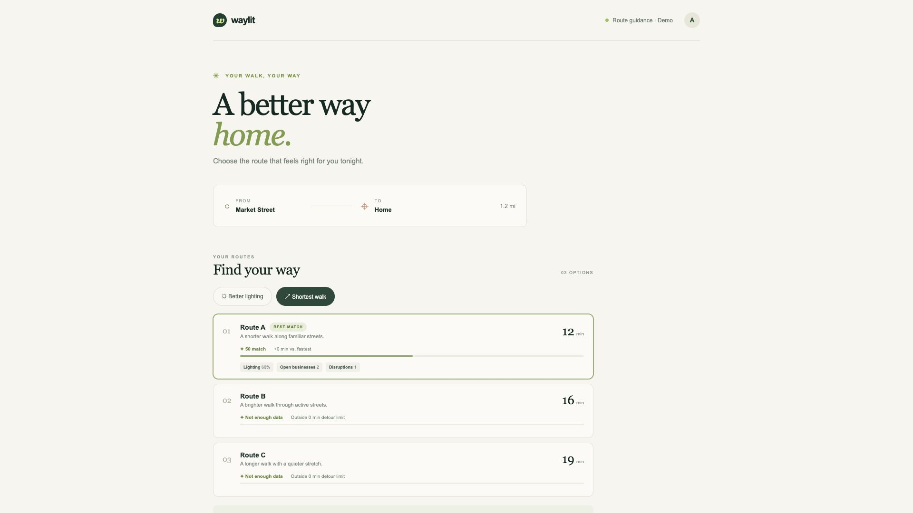

# Hackathon Evidence

Evidence reviewed on 2026-10-24 for the `initial-setup` branch and open PR #1.

## SDK and build checks

- `npm test`: passed, 8 tests.
- `npm run build`: passed after the favicon and explanation changes.
- The React demo imports `evaluateRoutes` from `src/sdk` and renders its recommendation, scores, eligibility, factor observations, and explanation. No separate recommendation calculation is used in the UI.
- Synthetic fixture: Better Lighting selects Route B and excludes Route C at +7 minutes; Shortest Walk selects Route A and excludes the longer routes.

## Kane browser runs

### Existing run: `waylit-preset-check`

- Result: passed in 82.6 seconds, using 31.48 credits.
- Verified Better Lighting initially selected Route B, then Shortest Walk selected Route A and marked Route B outside the 0-minute detour limit.
- The saved console log contained one resource 404. The HAR did not identify a failed request; a direct check confirmed `/favicon.ico` returned 404.
- Local evidence pack: `49807f3c-da4e-4886-8fdb-53580b8431a6.evidence`; validation status: finalized.

### Follow-up run: `waylit-evidence-check`

- Result: passed in 63.9 seconds, using 27.63 credits.
- Verified the displayed route times and lighting values, Route B's Better Lighting recommendation, Route C's +5-minute exclusion, and the Better Lighting explanation.
- After switching presets, verified Route A's Shortest Walk recommendation, Route B's zero-minute exclusion, and the explanation that no environmental superiority is implied.
- Kane reported zero browser console errors at both preset checkpoints.
- Local evidence pack: `0b70ad53-af70-411b-b9a3-446c0f3ae442.evidence`; validation status: finalized.

Screenshots from that run:





### Tracked-test replay

- Command: `KANE_CLI_USER_AGENT=codex kane-cli testmd run tests/kane/waylit-evidence-check_test.md --agent --headless`.
- Result: passed in 13 seconds; 1/1 test step passed, 16 recorded actions replayed, and no steps were re-authored.
- The replay result was uploaded to Test Manager, but no share URL was returned.

The second run confirmed and fixed the 404 by declaring `/favicon.svg` in `index.html` and adding `public/favicon.svg`. A direct request to the new asset returned HTTP 200.

The Kane-generated test definition is in [`tests/kane/waylit-evidence-check_test.md`](../tests/kane/waylit-evidence-check_test.md). Re-run from the repository root with:

```sh
KANE_CLI_USER_AGENT=codex kane-cli testmd run tests/kane/waylit-evidence-check_test.md --agent --headless
```

Only the generated test definition is included in the repository. Its 260 KB local replay bundle was omitted because generated metadata contains personal Test Manager identifiers and remote screenshot URLs; a clean checkout may author the test once and consume credits.

The sealed `.evidence` packs remain in the ignored local `.testmuai/evidence/` directory and are not shared by this repository. The Test Manager records were saved to the account's `KaneAI Generated / route_cause` project; team access has not been verified. The Hack Day consent status is still undecided, so no run summary has been submitted to the team's Proof tab. Do not treat the personal Test Manager records or local packs as team-shared evidence.

## Not verified

- Live mapping providers, external environmental data, production hosting, and mobile behavior were not tested.
- No team-shared Kane evidence or submission draft has been verified.
- The demo uses synthetic observations and does not make safety guarantees.